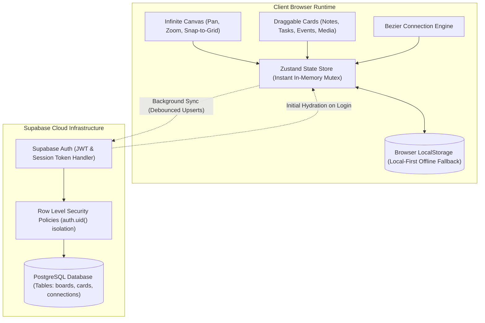

# Drag2Place

Drag2Place is an open-source, spatial personal workspace and dashboard inspired by Milanote. Designed for organizing thoughts, planning projects, tracking deadlines, and assembling visual moodboards on an infinite, hardware-accelerated freeform canvas.

Built with a local-first architecture, Drag2Place ensures instantaneous interactions with zero latency, offline resilience, and automatic cloud backup via Supabase PostgreSQL.

---

## Architectural Overview

Drag2Place couples client-side state responsiveness with cloud synchronization and strict Row-Level Security (RLS).



---

## Core Capabilities

### 1. Spatial Infinite Canvas
- **Freeform Viewport**: Navigate across unlimited spatial coordinates using `Space + Drag`, middle-mouse panning, or trackpad gestures.
- **Precision Zooming**: Zoom from 25% to 250% anchored dynamically to cursor coordinates via `Ctrl + Wheel` or trackpad pinch.
- **Right-Click Spatial Context Menu**: Contextual right-click menu anywhere on the canvas viewport to drop spatial comment pins at exact coordinates, spawn cards directly under the cursor, or reset the viewport.
- **Hardware-Accelerated Dragging**: Direct CSS transform hardware layer promotion with zero interpolation latency.
- **Dot Matrix Grid**: Responsive background matrix with optional 20px snap-to-grid alignment.

### 2. Multi-Board Workspaces
- **Isolated Boards**: Create independent spatial contexts (e.g., Daily Scratchpad, Engineering Roadmap, Creative Moodboard).
- **Workspace Switcher**: Top navigation menu for instantaneous board transitions.
- **Board Management**: Inline workspace renaming and safe deletion with confirmation modals.
- **Independent State**: Each workspace preserves its own viewport coordinates, zoom levels, card collections, and connection graphs.

### 3. Visual Card Suite
- **Notes and Prose**: Markdown-capable stationery notes with on-the-fly typography switching between authentic **Oregon LDO**, **Editorial Serif**, **Modern Sans**, and **Clean Monospace**. Features clean, uncluttered placeholders and auto-focus so users can immediately begin writing without deleting sample text.
- **Checklists and Tasks**: Dynamic to-do cards featuring completed counters, progress meters, priority badges, strikethrough transitions, and particle confetti upon task completion.
- **Code Snippet & Terminal**: Dark obsidian terminal window with line numbers, syntax formatting, copy button, and built-in JSON prettifier and validator.
- **Interactive Color Palettes**: Swatch cards with click-to-copy Hex/Pantone codes, real-time WCAG contrast ratio compliance badges (AA/AAA), and custom color addition.
- **KPI Goal Metrics**: Numeric target trackers with animated progress bars, percentage completion indicators, and quick adjustment buttons (+1, +10, -1, -10).
- **Canvas Comments & Spatial Pins**: Collaborative review pins placed at exact canvas coordinates via right-click. Designed as tactile circular avatar pins with expandable discussion balloons, drag repositioning, timestamps, and active/resolved status toggles.
- **Rich Web Link Previews**: Bookmark cards that fetch OpenGraph metadata, title, hero images, description snippets, and domain favicons.
- **Events and Deadlines**: Milestone tracking with calendar date pickers, times, location indicators, dynamic countdown badges (*Today*, *Tomorrow*, *In X days*), and customizable reminder intervals.
- **Media and Moodboards**: Image integration via URL or local file upload, accompanied by customizable captions and a full-screen lightbox modal.
- **Tactile Color System**: Curated warm minimalist palettes across seven tactile tones (*Paper, Cream, Sage, Terracotta, Amber, Lavender, Sky*).

### 4. Curved Bezier Connectors
- **Milanote-Style Vector Connections**: Connect cards with interactive cubic bezier curves and directional arrowheads.
- **Two-Step Connection Workflow**: Activate the connect tool from the dock, select an origin card, and click any destination card to complete the vector path.
- **Connection Customization**: Interactive deletion triggers and label badges anchored along curve tangents.

### 5. Floating Bottom Dock
- **macOS-Style Magnification**: Spring-physics magnification on hover powered by Framer Motion.
- **Quick Spawn Actions**: Keyboard triggers (`N` for Note, `T` for Todo, `E` for Event, `I` for Image, `C` for Connect mode).
- **Embedded Brand Identity**: Clean typography and brand mark integration.

### 6. Command Palette and Global Search
- **Fuzzy Search Modal (`Ctrl + K`)**: Instantly index and search across note contents, task items, event locations, image captions, and workspace titles.
- **Viewport Auto-Fly**: Selecting a search match smoothly navigates and centers the infinite canvas viewport directly onto the targeted card.
- **Quick Commands**: Trigger card creation, board exports, and theme toggles directly from the keyboard interface.

### 7. Audio and Notification Engine
- **Procedural Audio Synthesizer**: Tactile soundscapes (woodblock clicks, marimba drops, mellow chimes) generated via the Web Audio API without external audio files.
- **Dual Notification System**: Native browser Push Notifications paired with an in-app slide-out alert drawer tracking active, overdue, and upcoming milestone reminders.

### 8. Cloud Synchronization and Local-First Resilience
- **Offline-First Persistence**: Workspaces are saved instantly to browser `localStorage` on every stroke, permitting complete offline functionality with zero UI latency.
- **Offline Draft Indicator**: Amber pulsing badge in the header whenever logged out, alerting the user that edits are currently stored on the device only with a one-click *"Sign in to Sync"* action.
- **Smart Re-Login Reconciliation**: When signing in, any offline edits or cards created while logged out are automatically merged and pushed to Supabase PostgreSQL without overwriting or losing work.
- **Batched Cloud Sync**: Debounced 3-second background batch upserts (`supabase.from(...).upsert([...])`) that bundle entire workspace updates into single requests, preventing infinite loops, server strain, and unnecessary network traffic.
- **Human-Friendly Status**: Plain-language sync indicators avoiding database jargon (live spinning sync indicator, serene emerald dot when synced).
- **Profile Popover**: User avatar, email badge, cloud sync status, and confirmation-guarded sign-out controls.

### 9. High-Resolution Export and Backups
- **2x Canvas PNG Capture**: Generate publication-ready PNG snapshots of visible canvas regions using `html-to-image`.
- **Portable JSON Backups**: One-click download of all workspaces, cards, and connection graphs into a single structured JSON file.
- **Complete Workspace Restore**: File picker to import and hydrate historical JSON backups.

### 10. Design System and Dual Themes
- **Warm Minimalist Light Mode**: Linen and paper backgrounds (`#FAF8F5`) paired with warm stone borders.
- **Obsidian Velvet Dark Mode**: Low-fatigue dark environment (`#141311`) designed for sustained focus.
- **Strict Visual Cohesion**: Standardized Lucide SVG iconography with zero emoji usage.

### 11. Role-Based Workspace Modes and Headstarters
Curated professional workspace presets featuring domain-tailored card content, checklists, milestone events, and moodboards:
- **Developer**: Microservices API specifications, SQL spatial migration scripts, sprint backlog with hotfix priorities, cluster cutover milestones, infrastructure topology diagrams, and SLA performance telemetry guardrails. Includes an alternative Open Source & Bug Triage scenario.
- **Designer**: Design system token hierarchies with WCAG AA contrast standards, usability sprint protocols, user research feedback quotes, interactive mobile prototypes, component redlines, and engineering handoff reviews. Includes an alternative Web Wireframing & IA scenario.
- **Video Editor**: Raw camera ingest specs (RED 8K VV / ProRes 4444 XQ), rough-cut to picture-lock assembly checklists, DaVinci Resolve color grade node trees with Kodak 2383 LUT recipes, anamorphic framing moodboards, multi-format export checklists (16:9, 9:16, 1:1), and client screening milestones.
- **Graphic Designer**: Luxury botanical brand identity manifests, Pantone & CMYK ink formulas, packaging tuck-end box die-line specifications, tactile paper and foil-stamp moodboards, vector export checklists, and offset printer press-check inspections.
- **Marketing**: Full-funnel SaaS Q3 launch strategies, high-converting copywriting matrices with 3 hook angles, digital ad creative mockups, launch activation checklists, acquisition KPI trackers, and Product Hunt live war rooms.
- **Influencer**: Sponsored campaign contract deliverables, 3-second viral hook script storyboards, overhead desk studio lighting setups, post-production captioning workflows, and prime social publishing windows.
- **Product Manager**: Lean Canvas hypotheses, customer pain point discovery, RICE feature scoring backlogs, user journey analytics dashboards, sprint OKRs, and executive product council reviews.
- **Architect & Interior Designer**: Biophilic architectural spatial concepts, Carrara marble and European white oak material schedules, municipal zoning & permit compliance checklists, and client schematic walkthrough milestones.
- **Music Producer & Audio Engineer**: Harmonic song arrangement sequences (BPM, key, meter), UAD Neve & Pultec vocal mixing signal chains, tracking passes, multi-track stems, and Apple Digital Master deliverables (-14 LUFS).
- **Author & Screenwriter**: 3-Act narrative conflict structures, psychological protagonist flaw dossiers, chapter word count trackers, subplot weaving checklists, and literary agent submission milestones.

---

## Technology Stack

| Layer | Technology | Version | Purpose |
|---|---|---|---|
| Framework | Next.js (App Router) | 16.4.3 | Server components, routing, optimized asset pipeline |
| Language | TypeScript | 5.x | Strict type safety, explicit unions, zero `any` types |
| Styling | Tailwind CSS | 4.x | Utility-first CSS engine with custom `@custom-variant dark` |
| State Management | Zustand | 5.0.16 | Global reactive state with decoupled persistence drivers |
| Backend & Auth | Supabase | 2.118.0 | PostgreSQL database, JWT authentication, RLS |
| Animations | Framer Motion | 14.6.0 | Physics-based spring docks and modal micro-interactions |
| Audio Engine | Web Audio API | Native | Procedural real-time acoustic waveform synthesis |
| Canvas Export | html-to-image | 1.11.13 | High-DPI canvas DOM rasterization |
| Iconography | Lucide React | 1.61.0 | Vector SVG icons conforming to WCAG AA contrast |
| Package Manager | pnpm | 11.x | Fast, disk-efficient package management |

---

## Directory Structure

```text
drag2place/
├── public/                      # Static assets, branding, and fonts
│   ├── fonts/                   # Luke Owens Oregon LDO TrueType binaries
│   ├── drag2placeLogo.png       # Primary 1080x1080 brand logo
│   └── favicon.ico              # Root favicon
├── src/
│   ├── app/                     # Next.js App Router root
│   │   ├── apple-icon.png       # Dynamic iOS touch icon endpoint
│   │   ├── icon.png             # Dynamic standard icon endpoint
│   │   ├── favicon.ico          # Dynamic browser tab favicon
│   │   ├── globals.css          # Tailwind CSS v4 variables & theme overrides
│   │   ├── layout.tsx           # Root layout, metadata, and font declarations
│   │   ├── oregon-font.css      # Base64 embedded Oregon LDO font definitions
│   │   └── page.tsx             # Canvas entry point
│   ├── components/
│   │   ├── canvas/              # Spatial engine
│   │   │   ├── CanvasControls.tsx   # Zoom, pan, snap, theme, sound toggles
│   │   │   ├── CanvasGrid.tsx       # Dot matrix canvas grid
│   │   │   ├── ConnectionLine.tsx   # Cubic bezier vector connections
│   │   │   └── InfiniteCanvas.tsx   # Canvas event coordinator
│   │   ├── cards/               #Draggable card suite
│   │   │   ├── CardWrapper.tsx      # Coordinates, drag mechanics, resizing, color menu
│   │   │   ├── EventCard.tsx        # Milestone and deadline card
│   │   │   ├── ImageCard.tsx        # Image and lightbox card
│   │   │   ├── NoteCard.tsx         # Rich typography stationery note
│   │   │   └── TodoCard.tsx         # Checklists with progress meter
│   │   ├── dock/                # Bottom navigation dock
│   │   │   └── FloatingDock.tsx     # Spring-physics floating dock
│   │   ├── navigation/          # Modals and header chrome
│   │   │   ├── AuthModal.tsx        # Authentication modal
│   │   │   ├── BoardSwitcher.tsx    # Multi-board dropdown switcher
│   │   │   ├── CommandPalette.tsx   # Global search and command modal (Ctrl + K)
│   │   │   ├── ExportModal.tsx      # PNG capture and JSON backup modal
│   │   │   ├── HeaderBar.tsx        # Top status bar, brand logo, profile dropdown
│   │   │   └── NotificationCenter.tsx # In-app notification drawer
│   │   └── ui/                  # Reusable presentation components
│   │       └── ConfirmationModal.tsx # Universal destructive action confirmation dialog
│   ├── lib/                     # Domain services and infrastructure
│   │   ├── supabase/
│   │   │   ├── client.ts        # Supabase client factory with offline fallback
│   │   │   └── schema.sql       # PostgreSQL migration schema with RLS policies
│   │   ├── notifications.ts     # Browser notification service
│   │   ├── sound.ts             # Web Audio API acoustic synthesizer
│   │   └── store.ts             # Primary Zustand store with sync drivers
│   └── types/
│       └── board.ts             # Strict TypeScript domain interfaces
├── .env.example                 # Template for environment credentials
├── .npmrc                       # Dependency hoisting configuration
├── eslint.config.mjs            # ESLint 9 flat configuration
├── next.config.ts               # Next.js configuration
├── package.json                 # Dependency manifest
└── tsconfig.json                # Strict TypeScript configuration
```

---

## Getting Started

### Prerequisites

- **Node.js**: Version `20.x` or `22.x`
- **pnpm**: Version `10.x` or `11.x` (Recommended)

### 1. Clone the Repository

```bash
git clone https://github.com/PramudithaN/drag2place.git
cd drag2place
```

### 2. Install Dependencies

```bash
pnpm install
```

### 3. Configure Environment Variables

Duplicate `.env.example` to create your local environment file:

```bash
cp .env.example .env.local
```

Populate the configuration values:

```env
NEXT_PUBLIC_SUPABASE_URL=https://your-project-id.supabase.co
NEXT_PUBLIC_SUPABASE_ANON_KEY=your-anon-public-key
```

*Note: If you do not configure Supabase credentials, Drag2Place automatically boots in full offline mode, persisting all data to your browser's local storage.*

### 4. Initialize Database Schema (When using Supabase)

1. Open your **Supabase Dashboard** and navigate to the **SQL Editor**.
2. Paste the contents of `src/lib/supabase/schema.sql`.
3. Execute the script to initialize tables (`boards`, `cards`, `connections`) and Row-Level Security policies.
4. Under **Authentication** -> **URL Configuration**, set your **Site URL** (e.g., `http://localhost:3000` for local or `https://your-domain.com` for production).

### 5. Launch the Development Server

```bash
pnpm run dev
```

Navigate to [http://localhost:3000](http://localhost:3000) in your browser.

---

## Verification and Quality Runbook

Before committing any modifications, ensure the project adheres to all quality gates:

```bash
# 1. Lint and code style check
pnpm run lint

# 2. Strict TypeScript compilation check
npx tsc --noEmit

# 3. Production build verification
pnpm run build
```

---

## Keyboard Shortcuts Reference

| Shortcut | Context | Action |
|---|---|---|
| `Space + Click + Drag` | Canvas | Pan across the infinite canvas |
| `Ctrl + Scroll` | Canvas | Zoom viewport anchored to mouse cursor (25% - 250%) |
| `Ctrl + K` or `Cmd + K` | Global | Toggle Global Command Palette & Search |
| `N` | Canvas | Create a new Note Card at viewport center |
| `T` | Canvas | Create a new Checklist Card at viewport center |
| `C` | Canvas | Create a new Code Snippet & Terminal Card |
| `P` | Canvas | Create a new Color Palette Card |
| `M` | Canvas | Create a new KPI Metric Goal Card |
| `E` | Canvas | Create a new Event Card at viewport center |
| `I` | Canvas | Create a new Media Card at viewport center |
| `Delete` or `Backspace` | Card Selected | Open deletion confirmation dialog for selected cards |
| `Escape` | Modals / Dialogs | Close active dialog or cancel active connection |
| `Enter` | Confirmation Dialog | Confirm dialog action |

---

## Deployment Guide

### Vercel Deployment (Recommended)

1. Push your repository to GitHub.
2. Visit [Vercel](https://vercel.com/new) and import `drag2place`.
3. In **Environment Variables**, define:
   - `NEXT_PUBLIC_SUPABASE_URL`
   - `NEXT_PUBLIC_SUPABASE_ANON_KEY`
4. Click **Deploy**.
5. Update your Supabase **Site URL** and **Redirect URLs** to match the generated Vercel domain (`https://<project-name>.vercel.app/**`).

---

## Contributing

Contributions are welcome. Please adhere to the following workflow:

1. Fork the repository.
2. Create a feature branch: `git checkout -b feat/your-feature-name`.
3. Verify changes with the quality runbook (`lint`, `tsc`, `build`).
4. Commit your changes following **Conventional Commits**:
   - `feat(scope): add new capability`
   - `fix(scope): resolve bug or regression`
   - `perf(scope): improve rendering performance`
   - `refactor(scope): restructure module without behavioral change`
   - `docs(scope): update documentation`
5. Push to your branch and submit a Pull Request.

---

## License

This project is licensed under the [MIT License](LICENSE).
